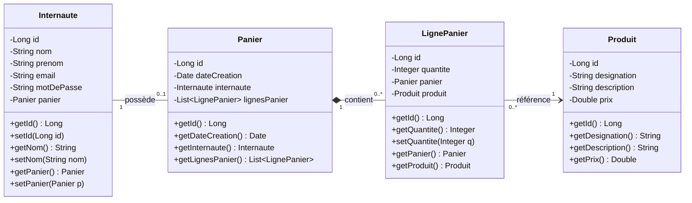
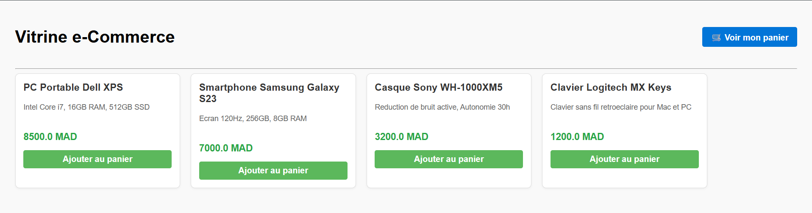
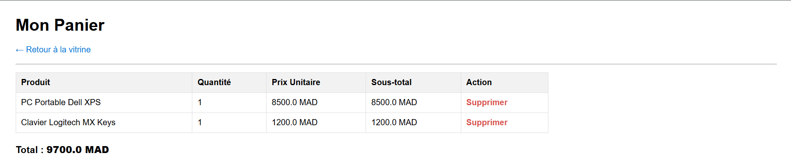

# Rapport d'Atelier : Application Web basée sur MVC 2 et JPA

---

**Université Abdelmalek Essaadi**  
**Faculté des Sciences et Techniques de Tanger (FSTT)**  
**Département Génie Informatique**  
**Cycle Ingénieur : LSI (Logiciels et Systèmes Intelligents)**  
**Module :** JEE  
**Encadré par :** Pr. ELAACHAK LOTFI  

---

## 1. Objectifs de l'Atelier

L'objectif principal de cet atelier est la mise en œuvre pratique de l'architecture **MVC 2 (Modèle - Vue - Contrôleur)** couplée à l'API **JPA (Java Persistence API)** à travers le développement d'une application web e-Commerce simulant la gestion d'une vitrine de produits et d'un panier d'achat.

Les compétences visées sont :
- La modélisation relationnelle et objet des concepts clés d'un site e-commerce (*Internaute, Panier, LignePanier, Produit*).
- L'utilisation de **JPA** et du fournisseur de persistance **EclipseLink** pour le mapping objet-relationnel (ORM) et la génération automatique du schéma de base de données dans **MySQL**.
- L'application stricte du patron de conception **MVC 2** :
  - **Modèle :** Entités JPA et transactions gérées via `EntityManager`.
  - **Contrôleur :** Servlets multi-actions routant les flux métier via des paramètres d'action (`action=lister`, `action=ajouter`, `action=supprimer`).
  - **Vue :** Pages JSP dynamiques tirant parti des balises **JSTL** et enrichies avec l'API JavaScript **jQuery**.

---

## 2. Outils et Environnement Technique

| Composant | Technologie / Outil | Rôle |
|---|---|---|
| **IDE** | IntelliJ IDEA Ultimate | Environnement de développement |
| **Serveur d'application** | Apache Tomcat 8.5.96 (Port 8081) | Conteneur de Servlets et JSP (Servlet 3.1) |
| **SGBD** | MySQL / MariaDB (via XAMPP, Port 3306) | Base de données relationnelle (`ecommerce_db`) |
| **Gestionnaire de dépendances** | Apache Maven | Construction, gestion des dépendances et packaging WAR |
| **Spécification ORM** | JPA 2.2 | API standard de persistance |
| **Implémentation JPA** | EclipseLink 2.7.14 | Fournisseur de persistance et génération DDL |
| **Pilote JDBC** | MySQL Connector/J 8.0.12 | Connectivité base de données |
| **Bibliothèque de balises** | JSTL 1.2 | Rendu dynamique dans les JSP sans scriptlets Java |
| **Client Scripting** | jQuery 3.6.0 | Dynamisme et micro-interactions utilisateur |

---

## 3. Étape 1 : Modélisation & Diagramme de Classes

L'application s'articule autour de quatre entités interconnectées :
1. **`Internaute`** : Représente le client du site e-commerce.
2. **`Panier`** : Associé à l'internaute (relation 1-à-1) et conservant la date de création.
3. **`Produit`** : Représente les articles de la vitrine avec leur désignation, description et prix.
4. **`LignePanier`** : Table d'association entre un `Panier` et un `Produit`, stockant la quantité sélectionnée.

### Diagramme de classes UML



---

## 4. Étape 2 : Configuration du Projet Maven (`pom.xml`)

Le projet est configuré sous forme de module Web dynamique packagé en archive `.war`.

Les dépendances clés configurées dans le fichier `pom.xml` sont :
- **`mysql-connector-java`** : Pilote JDBC officiel pour MySQL.
- **`eclipselink` (version 2.7.14)** : Intègre à la fois le moteur EclipseLink et l'API `javax.persistence` compatible avec les environnements Java modernes et les conteneurs Tomcat 8.5+.
- **`javax.servlet-api` (version 3.1.0, scope `provided`)** : Fourni par le conteneur Tomcat au moment de l'exécution.
- **`jstl` (version 1.2)** : Bibliothèque de balises standard pour les JSP.

```xml
<project xmlns="http://maven.apache.org/POM/4.0.0" ...>
    <modelVersion>4.0.0</modelVersion>
    <groupId>ma.fstt</groupId>
    <artifactId>Web_dynamique</artifactId>
    <version>1.0-SNAPSHOT</version>
    <packaging>war</packaging>

    <properties>
        <project.build.sourceEncoding>UTF-8</project.build.sourceEncoding>
        <maven.compiler.target>8</maven.compiler.target>
        <maven.compiler.source>8</maven.compiler.source>
        <maven.compiler.release>8</maven.compiler.release>
    </properties>

    <dependencies>
        <!-- Connecteur MySQL -->
        <dependency>
            <groupId>mysql</groupId>
            <artifactId>mysql-connector-java</artifactId>
            <version>8.0.12</version>
        </dependency>

        <!-- JPA & Fournisseur EclipseLink -->
        <dependency>
            <groupId>org.eclipse.persistence</groupId>
            <artifactId>eclipselink</artifactId>
            <version>2.7.14</version>
        </dependency>

        <!-- JSTL pour les vues JSP -->
        <dependency>
            <groupId>javax.servlet</groupId>
            <artifactId>jstl</artifactId>
            <version>1.2</version>
        </dependency>

        <!-- API Servlet fournie par Tomcat 8.5 -->
        <dependency>
            <groupId>javax.servlet</groupId>
            <artifactId>javax.servlet-api</artifactId>
            <version>3.1.0</version>
            <scope>provided</scope>
        </dependency>
    </dependencies>
</project>
```

---

## 5. Étape 3 : Couche Modèle et Persistance JPA

### 5.1. Fichier de Configuration `persistence.xml`
Situé sous `src/main/resources/META-INF/persistence.xml`, il configure l'unité de persistance (`eCommercePU`) et délègue à EclipseLink la création automatique des tables en base de données :

```xml
<?xml version="1.0" encoding="UTF-8"?>
<persistence version="2.0" xmlns="http://java.sun.com/xml/ns/persistence" ...>
    <persistence-unit name="eCommercePU" transaction-type="RESOURCE_LOCAL">
        <provider>org.eclipse.persistence.jpa.PersistenceProvider</provider>

        <class>ma.fstt.ecommerce.model.Produit</class>
        <class>ma.fstt.ecommerce.model.Internaute</class>
        <class>ma.fstt.ecommerce.model.Panier</class>
        <class>ma.fstt.ecommerce.model.LignePanier</class>

        <properties>
            <property name="javax.persistence.jdbc.driver" value="com.mysql.cj.jdbc.Driver" />
            <property name="javax.persistence.jdbc.url" value="jdbc:mysql://localhost:3306/ecommerce_db?serverTimezone=UTC" />
            <property name="javax.persistence.jdbc.user" value="root" />
            <property name="javax.persistence.jdbc.password" value="" />

            <!-- Génération automatique des tables dans MySQL -->
            <property name="eclipselink.ddl-generation" value="create-tables" />
            <property name="eclipselink.logging.level" value="FINE" />
        </properties>
    </persistence-unit>
</persistence>
```

### 5.2. Gestionnaire Thread-Safe `JPAUtil`
Conformément aux bonnes pratiques JPA, `EntityManagerFactory` est une ressource lourde et thread-safe instanciée une seule fois via un bloc statique. `EntityManager` étant non thread-safe, `JPAUtil` fournit des instances dédiées par requête :

```java
package ma.fstt.ecommerce.util;

import javax.persistence.EntityManager;
import javax.persistence.EntityManagerFactory;
import javax.persistence.Persistence;

public class JPAUtil {
    private static final EntityManagerFactory emf;

    static {
        try {
            emf = Persistence.createEntityManagerFactory("eCommercePU");
        } catch (Throwable ex) {
            System.err.println("Échec d'initialisation de l'EntityManagerFactory: " + ex);
            throw new ExceptionInInitializerError(ex);
        }
    }

    public static EntityManager getEntityManager() {
        return emf.createEntityManager();
    }
}
```

---

## 6. Étape 4 : Couche Contrôleur (Architecture MVC 2)

Suivant les consignes de l'atelier, chaque domaine fonctionnel dispose d'**une seule Servlet gérant plusieurs actions** via le paramètre de requête `action`.

### 6.1. `ProduitServlet` (Gestion de la vitrine : `/vitrine`)
- Récupère la liste des produits via une requête JPQL (`SELECT p FROM Produit p`).
- Transmet la collection à la vue JSP via `request.setAttribute("produits", produits)`.
- Redirige vers `/vitrine.jsp` par *forward*.

### 6.2. `PanierServlet` (Gestion du panier : `/panier`)
Gère trois actions fondamentales en respectant le cycle de vie de la session HTTP et les transactions ACID :
1. **`action=afficher`** (ou par défaut) : Récupère les lignes du panier en base de données et effectue un *forward* vers `/panier.jsp`.
2. **`action=ajouter`** :
   - Récupère le produit sélectionné via son identifiant `idProduit`.
   - Vérifie si le produit figure déjà dans le panier de l'internaute :
     - Si oui, incrémente simplement la quantité existante.
     - Si non, instancie et persiste une nouvelle entité `LignePanier`.
   - Effectue un `sendRedirect` vers `/vitrine?action=lister` (patron *Post/Redirect/Get* évitant les soumissions multiples).
3. **`action=supprimer`** : Supprime la ligne de panier spécifiée par `idLigne` via une transaction JPA (`em.remove()`) puis redirige vers `/panier?action=afficher`.

---

## 7. Étape 5 : Couche Vue (JSP, JSTL & jQuery)

### 7.1. Vitrine de Produits (`vitrine.jsp`)
- Utilise la balise JSTL `<c:forEach var="p" items="${produits}">` pour itérer proprement sur le catalogue sans scriptlet Java.
- Intègre un script **jQuery** ajoutant une animation réactive lors du clic sur le bouton *"Ajouter au panier"* pour informer l'utilisateur.

### 7.2. Page Panier (`panier.jsp`)
- Affiche sous forme de tableau responsive les articles ajoutés avec leur désignation, quantité, prix unitaire et sous-total calculé dynamiquement grâce à la balise `<c:set var="total" ... />`.
- Affiche un message convivial lorsque le panier est vide.
- Propose un lien direct de suppression par ligne et un lien de retour vers la vitrine.

### 7.3. Point d'entrée (`index.jsp` & `web.xml`)
Le fichier `index.jsp` configuré dans `<welcome-file-list>` du `web.xml` assure la redirection automatique dès l'ouverture de l'application :

```jsp
<%@ page contentType="text/html;charset=UTF-8" language="java" %>
<%
    response.sendRedirect(request.getContextPath() + "/vitrine");
%>
```

---

## 8. Démonstration et Validation

L'application a été validée avec succès sur le serveur **Apache Tomcat 8.5** sur le port **8081** :

### 8.1. Vitrine de Produits (`/vitrine`)
Affichage dynamique des produits récupérés depuis la base de données MySQL via JPA, avec leur désignation, description, prix et l'action d'ajout au panier :



### 8.2. Gestion du Panier (`/panier`)
Affichage du panier de l'internaute stocké en base de données, avec calcul dynamique des sous-totaux et du montant total en JSTL, ainsi que la possibilité de supprimer des articles :



### 8.3. Scénario de test validé
1. **Accès au catalogue :**
   ```text
   http://localhost:8081/Web_dynamique_war_exploded/
   --> Redirection immédiate vers /vitrine
   ```
2. **Ajout d'articles au panier :** Clic sur *"Ajouter au panier"*, mise à jour en temps réel des quantités en base de données MySQL.
3. **Consultation et suppression :** Accès à la page panier affichant le détail des produits, les sous-totaux, le total général et la suppression d'une ligne avec rafraîchissement immédiat.

---

## 9. Conclusion

Cet atelier a permis de maîtriser l'intégration complète d'une pile JEE moderne :
- Séparation stricte des responsabilités selon le patron **MVC 2**.
- Persistance transparente des objets métier grâce à **JPA** et **EclipseLink**.
- Utilisation des technologies de présentation recommandées (**JSTL**, **jQuery**).
- Gestion de la concurrence et du cycle de vie des sessions HTTP dans un contexte e-commerce réel.

